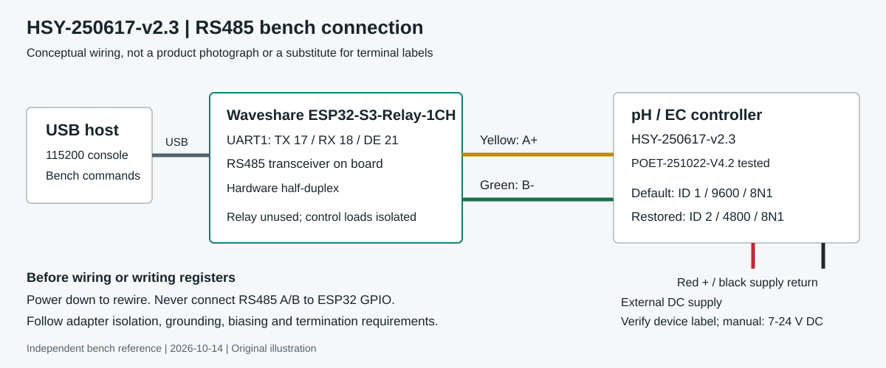

# HSY-250617 pH / EC Controller: RS485, Modbus and Reset

An independent, evidence-backed reference for the unbranded **Water Quality
Sensor / Five-in-One Water Quality Sensor** controller with PCB marking
**HSY-250617-v2.3**, tested firmware string **POET-251022-V4.2**.

Wiring, Modbus RTU register notes, calibration troubleshooting, an observed
settings reset, and an ESP32-S3 bench tool. Not an official manufacturer manual.
Similar enclosures and BGT-WMPS(O1) manuals do **not** establish identical firmware.

## Start here

- **[Complete controller guide](docs/controller-guide.md)**: identification,
  wiring, front-panel operation, RS485 frames, register map and limitations.
- **[Reset and recovery](docs/reset-recovery.md)**: exact reset command,
  before/after evidence and restoration to ID 2 / 4800.
- **[Manuals and sources](manuals/README.md)**: V1.5 and BGT manual comparison,
  source links, contradictions and redistribution status.
- **[ESP32-S3 bench firmware](firmware/README.md)**: Waveshare
  ESP32-S3-Relay-1CH wiring, build instructions and raw diagnostics.
- **[Bench evidence index](evidence/README.md)**: raw captures, including failed
  experiments and the explicitly unreliable early sweep.

## The useful finding

On **one tested HSY-250617-v2.3 / POET-251022-V4.2 unit**, Modbus function `06`
writing **`0x0037 = 0x0001`** produced a settings/calibration reset-like effect.
Communications returned to **ID 1, 9600 baud, 8N1**, calibration-related registers
changed, and the reading in the same pH 9.18 buffer moved from about **5.78 to
8.85**. [Exact procedure and warnings](docs/reset-recovery.md).

**This is not a harmless reboot. It affects stored settings and calibration.
Disconnect dosing/control loads, record settings, and recalibrate before use.
Do not apply it to unrelated controllers or broadcast it on a shared bus.**

The bench controller was subsequently restored programmatically to **ID 2 /
4800 baud / 8N1** using `0x0030=2`, then `0x0031=0x4800`. Readback and three
measurement replies verified that state (9.30, 9.29, 9.30 pH). Those later
readings are not the immediate reset result or a certification of accuracy.
Full calibration success, power-cycle persistence and long-term stability have
not been established. [Raw restoration log](evidence/2026-10-14_restore-comms.txt).

## Evidence labels

| Label | Meaning |
| --- | --- |
| **Bench-tested** | Observed on the identified unit, with raw evidence where available |
| **Manual** | Stated by a named manual; may be variant-specific |
| **Hypothesis** | Interpretation, not a proven register meaning or root cause |
| **Unverified** | Not exercised or insufficient evidence |

EC and temperature were zero during these tests. Their accuracy and EC scaling
on this unit have not been verified. Never assume that a write echo proves
successful calibration. The older and newer BGT manuals use different
calibration registers; see the [compatibility warning](manuals/README.md).

## Contributing useful evidence

Open an issue with PCB marking, firmware string, clear hardware photos,
adapter and framing, exact CRC-checked request/reply, buffer label/temperature,
front-panel result, and whether settings survived a power cycle. Remove serial
numbers, location details, credentials and unrelated device logs. Do not post
uncontrolled register-write sweeps as a recommended repair procedure.

Documentation snapshot: **2026-10-14, Australia/Sydney**. Original diagrams are
conceptual illustrations, not product photographs. See [asset credits](assets/README.md).
Original repository material is covered by [LICENSE](LICENSE); third-party
manuals, linked pages, images and trademarks retain their owners' rights.
