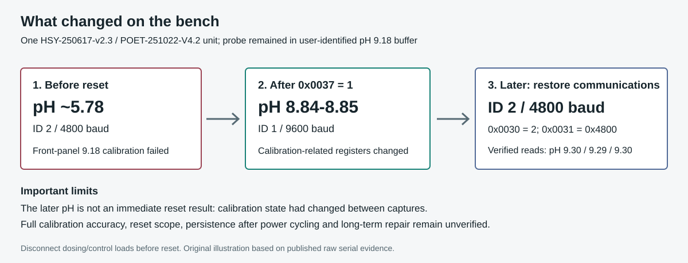

# Observed reset and recovery

## Safety and compatibility

This is a one-unit observation on **HSY-250617-v2.3 / POET-251022-V4.2**.
Disconnect dosing/control outputs and use an isolated bench before attempting
it. Save settings and register reads first. Treat it as a **whole-settings
reset with incompletely mapped scope**, not a harmless communications restart.
Do not copy it to other models or retry it automatically.

## Exact command

Use function **06 (write single holding register)**, zero-based register
**0x0037 (55 decimal)**, value **1** at the unit's current address and baud.

At ID 2 / 4800 / 8N1 the observed full request and echo were:

```text
TX: 02 06 00 37 00 01 F9 F7
RX: 02 06 00 37 00 01 F9 F7
```

The equivalent bench-tool PDU command is `x 10000 0600370001`. It adds the
active slave ID and CRC. Do not paste the ID-2 full frame at ID 1. No reset
is performed automatically by the supplied firmware.

After the echo, the old bus settings stopped answering. An initial discovery
scan failed; a later scan found **ID 1 / 9600 / 8N1**. The required settling
delay is unknown. Reconnect/read at defaults before considering another write.

## What changed

The probe stayed in the same owner-identified 9.18 buffer. Physical display
and RS485 agreed on the improved reading. The immediate post-reset capture
preceded further controller writes.

| Item | Before reset | After reset |
| --- | --- | --- |
| Measurement in 9.18 buffer | About 5.78 | 8.84-8.85 |
| Slave address, 0x0030 | 2 | 1 |
| Baud encoding, 0x0031 | 0x4800 | 0x9600 |
| Trigger, 0x0037 | 0 before write | 0 on later readback |
| 0x0062 / 0x0063 / 0x0064 | 569 / 659 / 733 | 0xAAAA / 0 / 0 |
| 0x0069 | 2 | 0x0AFF |
| 0x00A4 | 0xB188 in earlier paced map | 0 |

0x006A was zero after reset, but an earlier experiment had already cleared it.
Do not attribute that change solely to reset or call it calibration success.
0x006B-0x006D also changed; their meaning and whether they are live values are
unknown. **A stored-state problem contributed to the symptom; a specific
firmware bug, memory corruption mechanism or hardware root cause is unproven.**



## Communications restored afterward

At the owner's request, **ID 2 / 4800 / 8N1** was restored and verified:

| Current bus | Write | Full RTU request / echo | Next bus |
| --- | --- | --- | --- |
| ID 1 / 9600 | 0x0030=2 | `01 06 00 30 00 02 08 04` | ID 2 / 9600 |
| ID 2 / 9600 | 0x0031=0x4800 | `02 06 00 31 48 00 EE 36` | ID 2 / 4800 |

After each write, discovery and register readback verified the transition.
Three final measurement replies were **9.30, 9.29, 9.30 pH**. Immediately
before and after these writes, 0x0062-0x0064 were **590 / 477 / 700**.
These later values had already changed since the reset snapshot before the
communications operation started. The intervening front-panel calibration
outcome was not reported; do not label the later reading an immediate reset
result or successful full calibration. No calibration/reset write was sent
during the communications restoration.

## Experiment chronology

1. In 9.18 buffer, initial pH was about 5.87-5.89, matching the display.
2. Serial point-selection writes echoed but did not correct the reading.
3. In 6.86 buffer, front-panel calibration succeeded; pH read 6.86-6.87 and
   calibration-related values changed.
4. Returning to 9.18 produced 5.78-5.81; front-panel calibration failed.
5. Standard diagnostic/identification requests did not establish a reset.
   Some replies were CRC-valid but used nonconforming exception functions.
6. Temporary writes to A2/A3 and mode/point fields did not repair the fault;
   reversible changes were restored. Clearing 0x006A persisted because a
   write of its earlier 0xFFFF value was rejected.
7. The `0x0037=1` write produced the documented recovery and default settings.
8. Communications were restored and verified separately, as above.

Do not replay failed experiments as a repair script. The observations and
negative results are published to prevent overclaiming and unnecessary repeats.

## Primary evidence

- [Reset write/echo](../evidence/2026-10-14_control-0037.txt)
- [Initial failed scan](../evidence/2026-10-14_after-0037-rescan.txt)
- [Rediscovery at defaults](../evidence/2026-10-14_reset-defaults-reconnect.txt)
- [Post-reset registers](../evidence/2026-10-14_post-reset-registers.txt)
- [Paced pre-experiment map](../evidence/2026-10-14_paced-raw-map.txt)
- [Verified ID/baud restoration](../evidence/2026-10-14_restore-comms.txt)

Still required before claiming a complete repair: successful reference-buffer
calibration/checks, power-cycle readback, and stability testing.
