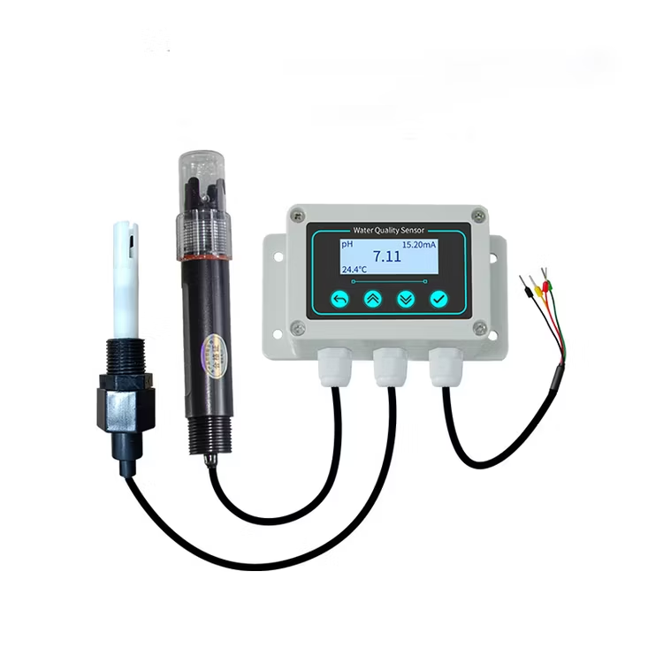

# Finding a reset through black-box RS485 probing

## Target and result

This is an AI-assisted investigation of one unbranded **5 in 1 water quality
sensor**, PCB **HSY-250617-v2.3**, reporting **POET-251022-V4.2**. Its physical
display and RS485 measurement both read about 5.8 in pH 9.18 buffer. A successful
front-panel 6.86 calibration did not resolve the alkaline calibration failure.

Writing `1` to holding register `0x0037` with Modbus function `06` produced a
settings/calibration reset-like effect. Communications reverted from ID 2 / 4800
to ID 1 / 9600, and the reading in the unchanged buffer became 8.84-8.85.
This establishes a useful black-box behavior, not the internal implementation
or a complete repair. [Exact reset/recovery record](reset-recovery.md).



## What AI actually did

I used an AI coding assistant to help build the serial bench tooling, compare
inconsistent manuals, propose candidate transactions, run iterative experiments
through the connected adapter, and interpret the captured replies. I handled
the physical wiring, moved the electrode between buffers, and reported the
controller's front-panel readings and calibration results.

I asked it to brute-force a recovery. In practice this was **bounded candidate
probing and hypothesis testing**, not an exhaustive search of every 16-bit
register/value pair. There was no firmware dump, disassembly, credential attack,
or authentication bypass. The public evidence supports one reset trigger, not
a catalogue of all possible resets.

The AI's explanations were hypotheses until checked against actual traffic and
physical observations. A particularly important correction was rejecting an
apparently plausible register map produced by an overly fast read sweep.

## Physical and protocol setup

- Waveshare ESP32-S3-Relay-1CH used as a USB-connected RS485 bench adapter.
- UART1: TX17, RX18, DE21; hardware half-duplex, 8N1 framing.
- Controller cable: red supply +, black supply -, yellow RS485 A, green RS485 B.
- Raw Modbus PDU requests with bounded capture windows, timestamps and CRC checks.
- Published source v1.0.4 is build/native-tested; live recovery used v1.0.3.

[Firmware and setup](../firmware/README.md) and
[electrical notes](controller-guide.md#2-electrical-connection) describe the
adapter and supply distinctions. RS485 A/B must not be wired directly to TTL
UART pins. Verify the controller's supply rating independently.

## The timing trap: CRC-valid did not mean correctly attributed

Some replies arrived about **401 ms** after the request. An earlier sweep used
a **150 ms** request window, so a response could be attributed to a later
requested register. A function-03 response contains the byte count and data,
but does not echo the starting register address. CRC validation alone could
therefore accept a genuine frame while the software assigned it to the wrong
register.

Paced single requests exposed the mismatch. The repository marks the early map
as unreliable and retains the [paced map](../evidence/2026-10-14_paced-raw-map.txt)
as the useful reference. This was an instrumentation error, not proof that the
controller shuffled its registers. For similar work, keep one transaction
outstanding, allow for late traffic, and treat ambiguous replies as ambiguous.

## Negative results matter

Serial point-selection writes echoed without fixing the reading. Standard
diagnostic/identification requests did not establish a reset. Temporary writes
to A2/A3 and mode/point fields were mostly ineffective. Reversible changes were
restored, but clearing `0x006A` could not be reversed to its earlier `0xFFFF`
value: that restoration was rejected. Not every experiment was reversible.

The older related BGT sequence (`0x006F=0`, then `0x0069=1/2/3`) did not establish
successful calibration on this unit. The newer sequence (`0x007B=1`, then
`0x006A=1/2/3`) was not fully tested. Similar manuals are leads, not proof of
firmware identity. [Manual revision comparison](../manuals/README.md).

## The decisive transaction and independent checks

At ID 2 / 4800 / 8N1, the full RTU request and echo were:

```text
02 06 00 37 00 01 F9 F7
```

The [raw reset capture](../evidence/2026-10-14_control-0037.txt) records the echo.
The old settings stopped answering. An initial discovery scan failed; a later
scan [found ID 1 / 9600 / 8N1](../evidence/2026-10-14_reset-defaults-reconnect.txt).
The required settling time is unknown, so a timeout is not grounds to blindly
repeat the reset.

The stronger evidence was the combination of changed communications, changed
calibration-related state, and a changed physical measurement:

| Observation | Before | Immediate post-reset |
| --- | --- | --- |
| pH in the same 9.18 buffer | About 5.78 | 8.84-8.85 |
| Slave ID / baud | 2 / 4800 | 1 / 9600 |
| Registers 0x0062 / 0x0063 / 0x0064 | 569 / 659 / 733 | 0xAAAA / 0 / 0 |

The [post-reset reads](../evidence/2026-10-14_post-reset-registers.txt) were
captured before further controller writes. Stored state contributed to the
symptom; the precise firmware bug, corruption mechanism, or hardware cause
remains unknown. This is not just a harmless reboot.

## Restore communications without conflating it with calibration

The requested ID 2 / 4800 configuration was subsequently restored in two steps:

| Current settings | Register/value | Full frame |
| --- | --- | --- |
| ID 1 / 9600 | 0x0030 = 2 | `01 06 00 30 00 02 08 04` |
| ID 2 / 9600 | 0x0031 = 0x4800 | `02 06 00 31 48 00 EE 36` |

Discovery and readback verified each transition. Final samples were
9.30 / 9.29 / 9.30. However, the calibration-related values were already
590 / 477 / 700 before those communications writes and were unchanged afterward.
Those later samples cannot be attributed directly to the reset or baud change.
[Restoration evidence](../evidence/2026-10-14_restore-comms.txt).

## Limits and safer replication

Use an isolated, owner-authorized bench device with dosing/control outputs
disconnected. Save settings first, avoid broadcast writes and automatic write
retries, and account for unknown side effects and EEPROM wear. The failed
experiments are evidence, not a repair script to replay.

A write echo proves receipt, not successful calibration. Full reference-buffer
accuracy, power-cycle persistence, and long-term stability remain unverified.
No fresh hardware experiments were performed to prepare this article. The
repository includes [raw captures](../evidence/README.md), exact hardware identity,
and negative results so others can challenge the interpretation without relying
on an AI-generated claim.
